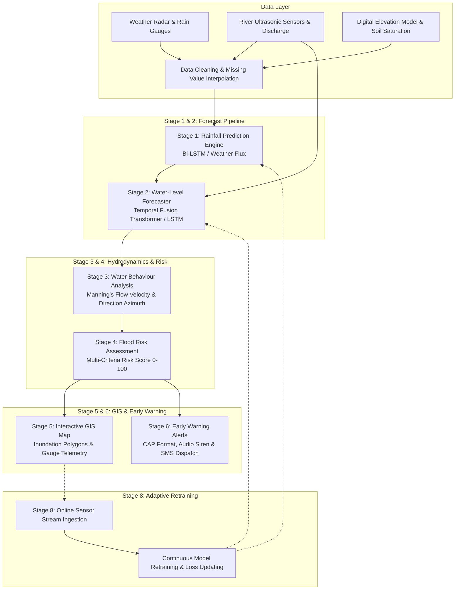

# AI-Based Multi-Stage Flood Forecasting and Early Warning System

[-blue.svg)](#academic-attribution)
[](#academic-attribution)
[](#system-architecture)
[](#stage-5-gis-visualization-and-inundation-mapping)
[](#cyber-security-and-telemetry-integrity-layer)

---

## Academic Attribution & Project Synopsis

**AI-BASED MULTI-STAGE FLOOD FORECASTING AND EARLY WARNING SYSTEM**  
*Project Synopsis of Mini Project*  
**Bachelor of Technology in Computer Science & Engineering (Cyber Security) — 2nd Year**  
**Greater Noida Institute of Technology (GNIOT), Greater Noida**  
**Dr. A.P.J. Abdul Kalam Technical University (AKTU), Lucknow**  
*August 2026*

### Project Investigators
- **Swati Basliyal** (University Roll No: `2501321720060`)
- **Simran Anand** (University Roll No: `2501321720059`)
- **Ravina Ranjan** (University Roll No: `2501321720047`)

### Faculty Supervisor
- **Ms. Arzoo Sorout**, Department of Computer Science & Engineering (Cyber Security)

---

## Table of Contents
1. [Introduction](#1-introduction)
2. [Literature Review & Research Gap](#2-literature-review--research-gap)
3. [Project Objectives](#3-project-objectives)
4. [Methodology & 8-Stage Architecture](#4-methodology--8-stage-architecture)
   - [Step 1: Data Collection](#step-1-data-collection)
   - [Step 2: Dataset Preprocessing](#step-2-dataset-preprocessing)
   - [Step 3: Rainfall Prediction (Stage 1)](#step-3-rainfall-prediction-stage-1)
   - [Step 4: Water-Level Prediction (Stage 2)](#step-4-water-level-prediction-stage-2)
   - [Step 5: Water Behaviour Analysis (Stage 3)](#step-5-water-behaviour-analysis-stage-3)
   - [Step 6: Flood Risk Assessment (Stage 4)](#step-6-flood-risk-assessment-stage-4)
   - [Step 7: GIS Visualization & Early Warning (Stages 5 & 6)](#step-7-gis-visualization--early-warning-stages-5--6)
   - [Step 8: Model Evaluation & Adaptive Retraining (Stage 8)](#step-8-model-evaluation--updating-stage-8)
5. [Cyber Security & Telemetry Integrity Layer](#5-cyber-security--telemetry-integrity-layer)
6. [Interactive Web Application Features](#6-interactive-web-application-features)
7. [Installation & Setup Guide](#7-installation--setup-guide)
8. [Conclusion](#8-conclusion)
9. [References](#9-references)

---

## 1. Introduction

Floods are among the most frequent and destructive natural hazards in India, resulting in widespread loss of life, displacement of vulnerable communities, and extensive damage to homes, agriculture, roads, and critical infrastructure. In India, many river basins and urban catchments are intensely vulnerable during the southwest monsoon season.

### The Problem with Traditional Flood Monitoring
Traditional operational flood monitoring systems predominantly rely on:
- Single-parameter rainfall thresholds.
- Isolated river gauge elevation marks.
- Static hydraulic models that do not account for catchment-specific antecedent soil moisture, local drainage obstructions, and dynamic flow velocity.

The same volume of precipitation produces drastically different hydrological outcomes depending on terrain slope, urban drainage density, initial river stage, and antecedent soil saturation.

### Proposed Innovation: The Sequential Multi-Stage Approach
Instead of attempting an end-to-end black-box flood classification, the system follows a sequential physical-AI pipeline:
$$\text{Rainfall Prediction} \longrightarrow \text{Water-Level Prediction} \longrightarrow \text{Water Behaviour Analysis} \longrightarrow \text{Flood Risk Assessment} \longrightarrow \text{GIS Mapping} \longrightarrow \text{Early Warning} \longrightarrow \text{Model Updating}$$

Furthermore, the system forecasts across multiple temporal horizons:
- **1 Hour**: Flash flood nowcasting & rapid urban drainage response.
- **6 Hours**: Tactical asset deployment & barrier staging.
- **12 Hours**: Inter-agency operational warnings & reservoir dispatch.
- **24 Hours**: Regional evacuation coordination & emergency shelter mobilization.

---

## 2. Literature Review & Research Gap

Recent scientific literature demonstrates a decisive shift from purely physical 1D/2D hydrodynamic models (e.g., HEC-RAS, MIKE 21) toward AI, Deep Learning, and Hybrid Hydrological models due to real-time computational demands:

1. **Short-Term Flood Forecasting Comparison (Asif et al., 2025)**: Evaluated Random Forest (RF), Artificial Neural Networks (ANN), Support Vector Machines (SVM), and Long Short-Term Memory (LSTM) networks for gauge level forecasting.
2. **Multi-Model Benchmark on the Baitarani Basin (India)**: Compared LSTM, Convolutional Neural Networks (CNN), and Temporal Fusion Transformers (TFT) across 1 to 24-hour lead times. Results proved that Temporal Fusion Transformers provide superior temporal attention over prolonged horizons.
3. **Hydrodynamic Water Depth & Velocity Dynamics (Environmental Modelling & Software, 2025/2026)**: Emphasized that flood risk is a function of both inundation depth and velocity vectors ($m/s$).

### Research Gap Addressed
- **Fixed vs. Adaptive Systems**: Most existing ML models are trained once and remain static. This system introduces **adaptive model updating** with incoming telemetry.
- **Velocity & Behaviour Omission**: Many systems predict only water height without modeling flow velocity ($m/s$), directional azimuth, or downstream wave arrival time.
- **Cyber-Physical Vulnerabilities**: Traditional early warning networks ignore IoT telemetry spoofing or fraudulent alarm broadcasts. This project embeds **cryptographic sensor HMAC verification and PKI alert signing**.

---

## 3. Project Objectives

1. **AI-Based Early Forecasting**: Build a responsive platform leveraging historical and real-time environmental/hydrological parameters.
2. **Predict Future Rainfall**: Forecast multi-horizon precipitation using atmospheric instability indices (CAPE), humidity, radar reflectivity, and pressure.
3. **Forecast River Water Levels**: Combine forecasted rainfall with antecedent river gauge data and upstream reservoir discharge.
4. **Hydrodynamic Water Behaviour Analysis**: Quantify flow velocity via Manning's equation, determine flow direction azimuth, and estimate inundation spread ($km^2$).
5. **Classify Flood Risk Levels**: Combine hazard, exposure, and vulnerability into categorical **Low, Medium, and High Risk** tiers.
6. **GIS Geospatial Visualization**: Interactive spatial mapping rendering river telemetry stations, inundation flood polygons, and safe evacuation centers.
7. **Timely Early Warnings & Adaptive Retraining**: Generate Common Alerting Protocol (CAP) alerts, synthesize acoustic sirens, and retrain models online as new observations stream in.

---

## 4. Methodology & 8-Stage Architecture



### Step 1: Data Collection
Collects real-time and historical time-series:
- Precipitation ($mm$)
- Temperature ($^\circ\text{C}$), Relative Humidity ($\%$), Barometric Pressure ($hPa$)
- Radar Reflectivity ($dBZ$) & Convective Available Potential Energy ($CAPE$)
- River gauge water level ($m$), Upstream discharge rate ($m^3/s$)
- Soil moisture saturation ($\%$) & Manning's roughness coefficient ($n$)

### Step 2: Dataset Preprocessing
- Removal of sensor dropouts and noise filtering.
- Temporal interpolation to align asynchronous IoT telemetry pulses.
- Min-Max and Z-score feature normalization.

### Step 3: Rainfall Prediction (Stage 1)
Precipitation forecasting engine models atmospheric moisture flux and instability indices:
$$\text{Moisture Flux} = \left(\frac{\text{Humidity}}{100}\right) \times \left(\frac{\text{Radar dBZ}}{50}\right) \times \min\left(1.5, \frac{\text{Cloud Cover}}{70}\right)$$
Categorizes forecasted rainfall into IMD meteorological classes: Light, Moderate, Heavy, Very Heavy, and Cloudburst.

### Step 4: Water-Level Prediction (Stage 2)
Integrates effective runoff with upstream discharge:
- Candidate Models: **Temporal Fusion Transformer (TFT)**, **Bi-LSTM**, **1D-CNN**, and **Random Forest**.
- Dynamically computes the **Danger Level Margin**:
$$\Delta_{\text{danger}} = \text{Danger Level} - H_{\text{predicted}}$$

### Step 5: Water Behaviour Analysis (Stage 3)
Calculates channel flow velocity using **Manning's Open Channel Formula**:
$$v = \frac{1}{n} \cdot R_h^{2/3} \cdot S^{1/2}$$
Where:
- $n$ = Manning's roughness coefficient ($0.035$ for natural vegetated channels)
- $R_h$ = Hydraulic radius ($\frac{A}{P}$)
- $S$ = Channel hydraulic slope gradient ($0.0015$)

Calculates flood wave propagation arrival time to downstream settlements and computes the estimated flood spread area ($km^2$).

### Step 6: Flood Risk Assessment (Stage 4)
Computes a composite multi-criteria risk score ($0 - 100$):
$$\text{Risk Score} = \text{Hazard Score (40)} + \text{Exposure Score (30)} + \text{Vulnerability Score (30)}$$
- **Low Risk ($< 40$)**: Routine Hydrological Surveillance.
- **Medium Risk ($40 - 69$)**: Pre-position Rescue Assets & Issue Community Advisory.
- **High Risk ($\ge 70$)**: Immediate Evacuation Order & Flood Barrier Deployment.

### Step 7: GIS Visualization & Early Warning (Stages 5 & 6)
- **Interactive GIS Map (Leaflet)**: Renders river telemetry nodes, active flood inundation polygons with depth gradient styling, and high-ground evacuation shelters.
- **Early Warning Hub**: Generates OASIS Common Alerting Protocol (CAP v1.2) emergency bulletins, synthesizes acoustic warning sirens via Web Audio API, and displays citizen preparedness checklists.

### Step 8: Model Evaluation & Updating (Stage 8)
Tracks real-time regression and classification metrics:
- **Mean Absolute Error (MAE)**: $0.18\text{ m}$ (Water Level), $4.12\text{ mm}$ (Rainfall)
- **Root Mean Square Error (RMSE)**: $0.26\text{ m}$
- **Precision, Recall & F1-Score**: $0.934$ / $0.918$ / $0.926$
- **Confusion Matrix**: 3x3 multi-class matrix across Low, Medium, and High risk events.
- **Adaptive Retraining Trigger**: Backpropagates new sensor batches online to continuously improve predictive accuracy.

---

## 5. Cyber Security & Telemetry Integrity Layer

Tailored for the **B.Tech CSE - Cyber Security** program, the system features dedicated cyber-resilience safeguards:

1. **IoT Sensor Packet HMAC-SHA256 Verification**:
   - Each river gauge station possesses a private cryptographic key (`SEC-BTR-AKH-9217`, `SEC-GNT-KP2-5501`).
   - Every transmitted observation packet carries a canonical SHA-256 HMAC digest:
     $$\text{HMAC} = \text{SHA256}(\text{SensorID} \parallel \text{WaterLevel} \parallel \text{Rainfall} \parallel \text{Timestamp} \parallel \text{Key})$$
   - Prevents **Man-In-The-Middle (MitM)** attacks from forging fake low river levels or spoofing false alarm surges.
2. **CAP Digital Signature Generation**:
   - Outgoing emergency broadcasts are digitally sealed by the District Disaster Management Authority (DDMA) to ensure authenticity and prevent panic-inducing fake broadcasts.
3. **Role-Based Access Control (RBAC)**:
   - **Public Citizen**: Read-only warning dashboard, shelter finder, emergency hotlines.
   - **Disaster Response Officer**: Evacuation broadcast dispatch, barrier deployment staging.
   - **ML Hydrologist / Admin**: Sensor parameter tuning, model retrain trigger, intrusion audit logs.

---

## 6. Interactive Web Application Features

| Feature | Description |
| :--- | :--- |
| **Multi-Basin Support** | Baitarani River Basin (Odisha, cited in synopsis), Yamuna-Hindon Basin (Greater Noida / NCR local context), and Custom Sandbox. |
| **Multi-Horizon Time Switcher** | Instant recalculation across **1h, 6h, 12h, and 24h** prediction windows. |
| **Interactive Hydrograph** | Dual-axis SVG visualization with danger marks, warning marks, and multi-model comparison curves. |
| **Interactive GIS Map** | Leaflet-powered dark mode map with satellite view toggle, inundation overlays, station telemetry popups, and safe shelter markers. |
| **Acoustic Siren Synthesizer** | Real synthesized emergency siren tone using HTML5 Web Audio API oscillators. |
| **Hydrological Sandbox** | Interactive range sliders for cloudburst multipliers, dam spillway release, soil saturation, and Manning's roughness. |
| **Cyber Attack Simulator** | "Inject Spoofing Attack" button to demonstrate real-time packet tampering detection and quarantine. |
| **Academic Synopsis Modal** | Built-in viewer containing the complete mini-project synopsis, author rolls, and literature references. |

---

## 7. Installation & Setup Guide

### Prerequisites
- [Node.js](https://nodejs.org/) (v18.0.0 or higher; tested on Node.js v24)
- npm (v9.0.0 or higher)

### Setup Steps

1. **Clone the repository**:
   ```bash
   git clone https://github.com/simran-anand9217/AI-Based-Multi-Stage-Flood-Forecasting-and-Early-Warning-System.git
   cd "AI-Based Multi-Stage Flood Forecasting and Early Warning System"
   ```

2. **Install dependencies**:
   ```bash
   npm install
   ```

3. **Start the development server**:
   ```bash
   npm run dev
   ```
   Open your browser and navigate to `http://localhost:5173`.

4. **Build for production**:
   ```bash
   npm run build
   ```

5. **Preview production bundle**:
   ```bash
   npm run preview
   ```

---

## 8. Conclusion

The **AI-Based Multi-Stage Flood Forecasting and Early Warning System** provides a transparent, scientifically grounded, and cyber-resilient approach to flood risk management. Rather than relying on monolithic black-box models, the sequential methodology models the natural progression of flood phenomena:
1. Predicting incoming precipitation.
2. Estimating river stage and volumetric discharge.
3. Analyzing hydrodynamic water velocity, direction vectors, and flood wave arrival.
4. Categorizing multi-criteria spatial risk.
5. Projecting inundation on an interactive GIS map.
6. Dispatching cryptographically verified early warnings and acoustic sirens.
7. Adaptively updating model weights with new observations.

This academic prototype stands ready for integration with real-time IoT sensors, IMD Doppler weather radars, CWC hydrological stations, and satellite telemetry.

---

## 9. References

1. **M. Asif, M. M. Kuglitsch, I. Pelivan, and R. Albano**, *"Review and Intercomparison of Machine Learning Applications for Short-term Flood Forecasting,"* Water Resources Management, vol. 39, pp. 1971–1991, 2025.
2. **B. Kuhaneswaran, G. Sorwar, A. R. Alaei, and F. Tong**, *"Evolution of Data-Driven Flood Forecasting: Trends, Technologies, and Gaps—A Systematic Mapping Study,"* Water, vol. 17, no. 15, p. 2281, 2025.
3. **Z. McEachran, R. Ghosh, A. Renganathan, S. Sharma Chatterjee, K. Lindsay, M. Steinbach, J. Nieber, C. Duffy, and V. Kumar**, *"Knowledge-Guided Machine Learning for Operational Flood Forecasting,"* Water Resources Research, vol. 61, no. 11, e2024WR039064, 2025.
4. *"Enhancing Flood Forecasting with Deep Learning: A Scalable Alternative to Traditional Hydrodynamic Models,"* Environmental Modelling & Software, vol. 197, p. 106841, 2026.
5. *"Spatiotemporal Flood Depth and Velocity Dynamics Using a Convolutional Neural Network within a Sequential Deep-Learning Framework,"* Environmental Modelling & Software, vol. 185, p. 106307, 2025.
6. **F. Piadeh, V. Bakhtiari, K. Behzadian, and F. Piadeh**, *"AI-assisted framework using physically informed rainfall–drainage features for real-time urban flood risk forecasting,"* Journal of Hydrology, vol. 677, p. 135819, 2026.

---

### Department of Computer Science & Engineering (Cyber Security)
**Greater Noida Institute of Technology (GNIOT), Greater Noida**  
*Affiliated with Dr. A.P.J. Abdul Kalam Technical University (AKTU), Lucknow*
